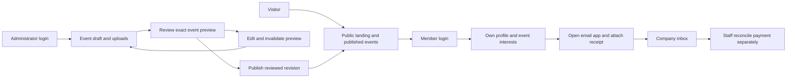

# ISP member and event experience — implementation plan

Prepared 25 October 2026, Asia/Kuala_Lumpur. Owner: project owner. Delivery director and PMO: Astra, high reasoning. Implementation and independent testing: GPT-6.1 Sol, extra-high reasoning. All project artifacts remain under D:\Projects\isp-member-rails. Repository: meithanr-creator/isp-malaysia-member-guide; implementation branch: rails-member-events; Rails source in rails-app/. Earlier static demo: https://isp-design-b-demo.pages.dev/.

## Outcome and scope

Visitors discover ISP and browse published events without signing in. The top-right member control opens login or the member dashboard. The landing body no longer repeats a member dashboard button. Discover becomes a rotating, accessible slideshow. The bottom navigation contains Events only. The remaining concept areas are preserved in the earlier demo, with any links from Rails explicitly labelled as earlier-demo references. This phase migrates the requested member/events/admin surfaces.

Members sign in, view their own profile and event interests, and register interest in a chosen event. Signing in returns them to that event. Interest is distinct from a booking or payment confirmation. Administrators prepare event details and assets, inspect the exact public preview, return to edit, and publish the reviewed revision.

This delivery produces redesigned Rails pages, a persisted local application using seeded sample accounts/events, and the production-backend specification. The earlier Cloudflare Pages demo has no secure authentication service or database. This Rails foundation uses sample records for review; real membership verification, recovery, administrator MFA and operational controls remain production gates. No real member data is introduced.

## Five redesigned surfaces

1. Landing: official ISP logo, top-right Login / My dashboard control and menu, plantation welcome image, Discover carousel, public event teaser and Events-only bottom bar. Carousel supports previous/next, pause/resume, position indicators, keyboard use and reduced-motion preference.
2. Login: recognisable member access layout with server-authenticated sample accounts, accurate recovery/help information, and clearly labelled local-review sample entry. An event-interest intent survives the login transition. A review URL alone never grants member or administrator identity.
3. Member dashboard: sample membership identity, editable permitted profile fields, event interests with status and withdrawal, clear route to browse events. Membership number/status and role are never member-editable in production.
4. Admin event editor: title, summary, description, event date/start/end/time zone, physical venue or online location, image and brochure, price/currency or free attendance, bank name, account name, account number, receipt destination email and payment instructions. Group fields into understandable sections with validation near the field.
5. Event preview/public detail: one renderer and one versioned event record for imagery, brochure, description, schedule, venue and payment instructions. Draft controls are outside the public content. Publish is possible only for the revision actually previewed. Editing an already published event creates a new draft while the public revision stays unchanged.

## Architecture decision — approved

The user confirmed Ruby on Rails on 25 October 2026. All application execution uses native Rails MVC, ERB views/partials, Active Record and small JavaScript interactions. Pin a currently patched Rails 8.1 release compatible with the installed Ruby runtime. Use SQLite for local review and PostgreSQL for eventual hosting. Use Rails sessions and a vetted password implementation; membership verification, recovery and admin MFA remain production requirements.

Project: D:\Projects\isp-member-rails. Ruby, gems and build tooling: D:\Projects\isp-rails-tools. The existing Ubuntu WSL environment failed to start; a verified official RubyInstaller development kit is installed on D. Keep secrets, logs, temporary files, database and uploads excluded from Git.

Active Storage files must be revision-scoped. Default public blob routes must be disabled or replaced for private draft assets; require an authorised download controller. Publish only accepted assets. Hosted storage is private object storage, with quarantine/scanning before publication.

A Rails-compatible process/server/container host is required. Cloudflare can provide DNS/proxy and assets, but the existing static Cloudflare Pages deployment cannot run Rails. No new paid hosting is provisioned in this phase. Local working Rails pages and a GitHub branch are the immediate deliverables; staging follows host/cost selection.

## Roles and server boundaries

The public event stays available while an administrator edits its next revision. Login, publication and interest changes are checked by Rails on the server. Opening an email app never marks a payment as received.

| Role | Permitted operations |
| --- | --- |
| Visitor | Read published event list and details; open approved public brochure; view landing/login. |
| Member | Read/update allowed fields of own profile; create/read/withdraw own event interest; see own registration/payment status. |
| Event administrator | Create/edit event drafts; upload permitted assets; preview; publish/archive; inspect event interests under authorised scope. |
| Payment verifier | Review externally received receipt evidence and mark a registration payment verified/rejected with an audit reason. Assign separately or explicitly combine with admin. |

The server derives the user and role from an authenticated session. Browser flags, query strings, hidden buttons, submitted member IDs or role selectors are never authorization evidence. Reject unauthorized private reads and writes even when an endpoint is called directly.

## Domain records

| Record | Important fields and constraints |
| --- | --- |
| User | Normalised unique email, verified-at, password/identity-provider reference, account state, session invalidation data. |
| Member profile | User ID, unique membership reference, membership status, display name, approved contact/profile fields. Owner-only access. |
| Role assignment | User ID, explicit role/permission, assigned-by and timestamps. No self-promotion. |
| Event | Stable ID/slug, lifecycle, published revision pointer, separate draft revision pointer. |
| Event revision | Version, author, title/summary/details, start/end/timezone, venue, image/brochure IDs, fee/currency, bank instructions, receipt email, timestamps. Published snapshots are immutable. |
| Asset | Generated key, original display name, actual detected type, size, hash, scan state, uploader, event/revision, visibility. |
| Event interest | Event ID, authenticated member ID, unique member/event pair, selected event/payment revision, participation and interest state. |
| Payment review | Interest/registration ID, expected amount/currency, verification state, reviewer, reason and timestamp. No card credentials. |
| Audit entry | Actor, action, target, revision, timestamp; avoid passwords, tokens and unnecessary personal contents. |

Enforce uniqueness and referential integrity in the database as well as application validation. Use transactions and optimistic version checks for concurrent edits and publication.

## State transitions and publication

Event drafts are private. Saving a draft increments its version. Preview records the version and content hash inspected. Publish validates required fields and accepted assets again, checks that the draft version still matches the preview, then atomically sets the published revision. Concurrent or subsequent edits invalidate that preview. A failed upload or failed publish leaves the previous public event intact. Editing a published record starts a separate revision; cancellation/archive is an explicit audited action.

Interest: interested → withdrawn. Repeated registration is idempotent and cannot create duplicate interests. Rejoining should follow the approved product rule. Capacity, waitlist and booking approval are optional later decisions, not implied by expressing interest.

Payment: not_required, or awaiting_payment → awaiting_verification → verified/rejected. Only an authorised verifier changes verification state. A member declaring that they sent a receipt is not proof of payment.

## Receipt-by-email flow

The event page shows the approved bank name, account name and account number with fee/currency and payment reference instructions. The receipt action opens the member's email application addressed to the approved company inbox, with event/reference information. The member attaches the receipt and sends it themselves. The application cannot infer that an email was sent, delivered or verified. Staff reconcile the inbox and record payment verification in the administration service.

Do not automatically send emails or invent a real bank account/inbox in the demo. Use clearly fictional placeholders. Define who owns the company inbox, how receipts are matched to registrations, duplicate handling, retention and escalation before the production pilot. Bank and recipient changes require privileged access, re-authentication and an audit trail; use a second reviewer if ISP's finance process requires one.

## Secure backend work packages

### Identity and profiles

Use invitation/account activation against the approved membership source; do not permit public users to claim a membership reference without verification. Verify email, use a vetted password hashing/session implementation, provide single-use expiring recovery links and generic recovery responses, rate-limit login/recovery, rotate session identifiers after authentication, and revoke sessions on relevant password/role/account changes. Require admin MFA and stronger re-authentication for privileged financial changes. Use Secure, HttpOnly and suitable SameSite cookies, HTTPS, CSRF protection for state changes, and safe same-origin post-login return paths. Decide session expiry with ISP before pilot.

### Event publishing and uploads

Validate all fields server-side; use plain text or a strict rich-text allowlist. Allow only approved JPEG/PNG/WebP and PDF types; verify file signatures rather than trusting extensions or browser MIME values. Set upload size/count limits, scan in quarantine, re-encode images, generate storage names, and reject executables/active formats. Draft assets require authorised access. Publish only accepted revision assets; brochure access uses safe content headers. Prevent arbitrary remote URL fetching. Treat browser-only checks as usability assistance.

### Interests and administration

Enforce own-record access on every member endpoint; derive member ID from the session. Validate event publication/registration availability and use a unique constraint for interest. Administrators receive only the event/member information needed for their role. Paginate lists, audit publication and payment decisions, and make failed operations retry-safe.

### Operations

Separate development/demo/staging/production configuration. Keep secrets in the hosting secret store and out of GitHub, browser bundles and logs. Run database migrations deliberately, maintain tested backups and restore procedures, centralise application errors without leaking personal data, and alert on service failures and privileged access anomalies. Do not cache authenticated pages or APIs in the public PWA service worker; clear relevant client data on sign-out. Specify retention and deletion rules before live member/receipt processing.

## Endpoint contract (logical routes; framework naming may vary)

- Public: GET /events; GET /events/:slug; approved public asset reads.
- Identity: POST /session; DELETE /session; activation and password-recovery endpoints with rate limits and token validation.
- Member: GET/PATCH /me; GET /me/interests; POST /events/:id/interests; DELETE /me/interests/:id. Ownership checked on every request.
- Admin: GET/POST /admin/events; GET/PATCH /admin/events/:id/draft; POST /admin/events/:id/preview; POST /admin/events/:id/publish with expected revision; POST /admin/assets; approved payment-verification endpoint.

Return explicit validation errors, unauthenticated/forbidden states, not-found and version-conflict responses. Never expose drafts through a public event lookup.

## Delivery controls

Track each milestone in MILESTONES.md with named owner, evidence, outstanding work and commit. Astra reviews scope, visual quality, risks and acceptance evidence. Sol implements and an independent Sol tester checks critical paths. The parent coordinates integration and local Rails review and GitHub delivery; hosted release follows compatible host selection. Work is reviewed after each meaningful milestone; failures reopen the milestone. Future automated unattended monitoring is not configured by this plan.

GitHub changes target the separate rails-member-events branch under rails-app/. Preserve the existing design-b-demo deployment. Record commit and deployment IDs; use a fresh branch-head check and an expected-head update to avoid overwriting other work. Production backend work should use a dedicated feature branch and reviewed pull request. The rollback reference for the prior demo is b7299c71cf511f57e7ea81e29e4ca7cbdf12c0d1.

## Decisions required before production activation

- Rails is confirmed. Select a compatible host and hosting budget.
- Source of member identity, invitation process and eligibility rules.
- Admin identities, MFA/recovery ownership and payment verifier responsibility.
- Approved company receipt inbox, bank instructions, fee/currency and finance process.
- Whether interest alone is sufficient, or capacity, waitlist, confirmation, cancellation/refund and notifications are needed.
- Permitted profile fields, retention, backup objectives and production domain.

## Primary technical references

- Rails security: https://guides.rubyonrails.org/security.html
- OWASP authentication: https://cheatsheetseries.owasp.org/cheatsheets/Authentication_Cheat_Sheet.html
- OWASP sessions: https://cheatsheetseries.owasp.org/cheatsheets/Session_Management_Cheat_Sheet.html
- OWASP authorization: https://cheatsheetseries.owasp.org/cheatsheets/Authorization_Cheat_Sheet.html
- OWASP uploads: https://cheatsheetseries.owasp.org/cheatsheets/File_Upload_Cheat_Sheet.html
- Cloudflare Pages Functions: https://developers.cloudflare.com/pages/functions/
